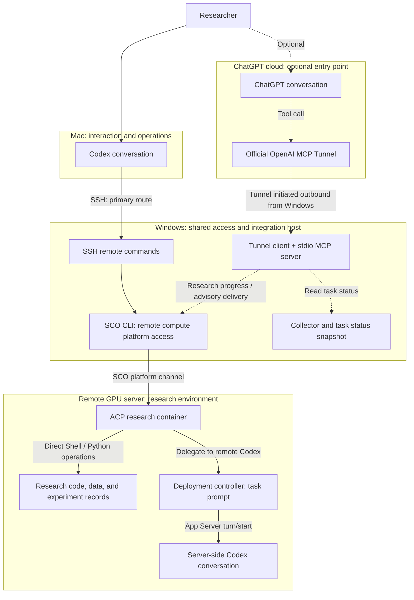

# AutoResearch Lab

**English** | [简体中文](README.zh-CN.md)

Persistent execution, process evaluation, and agent-native computing infrastructure for long-running autonomous research agents.

The primary route in our current deployment is **Codex on a Mac → SSH → Windows → the SCO CLI → a remote GPU research environment**. Research Hub packages components for status collection, platform integration, and advisory delivery, with an **optional MCP entry point from ChatGPT**.

**Project status: early research.** This repository contains a Python package extracted from a private Research Hub prototype, offline tests, and research plans. Synthetic demos and tests verify software behavior; real GPU campaigns and research outcomes require separate validation.

## Supported platform and portability

**The current live platform adapter targets SenseCore ACP through SCO.** SCO is SenseCore's platform-specific CLI, not a general-purpose SSH client or a tool provided by every GPU server. It can be installed on macOS, Windows, or Linux; our deployment uses Windows as the always-online gateway. See the [official SCO documentation](https://www.sensecore.cn/help/docs/CLI/Introduction).

The collector and Windows remote transport rely on SCO commands, ACP task identities, and platform response formats. The documented live validation covers that environment; it does not establish compatibility with arbitrary GPU servers or other cloud providers.

**A standard OpenSSH transport is now included** for a POSIX research host, without SCO or a Windows gateway. It supports isolated wheel deployment, fixed-session advisory delivery, reviewed progress reads, worker startup and a read-only doctor. Start with the [SSH setup guide](docs/ssh.md) and [example configuration](examples/ssh-deployment.example.json). The original SCO adapter remains available.

SSH task listing does not impersonate the ACP collector: it explicitly reports `platform_task_listing_not_supported`. The SSH route passed real loopback SSH/install/MCP checks with a simulated Codex RPC endpoint; arbitrary cloud providers, Windows SSH clients and real GPU/Codex deployments still need their own acceptance. See [test scope](docs/ssh-validation-2026-10-26.md). Windows is a choice in our original deployment, not a requirement for this new route.

## Actual use and functional boundaries

Our main daily entry point is **Mac Codex → SSH → Windows → SCO → the research container**. Once inside the container, operations take two distinct forms:

1. **Direct Shell/Python execution:** installing dependencies, editing files, reading logs, and running tests or experiment scripts. These operations do not necessarily involve server-side Codex and must not all be attributed to autonomous work by the server agent.
2. **Starting a server-side Codex turn:** a deployment controller submits a task prompt through Codex App Server `turn/start`. Server-side Codex then works within its configured tool permissions and budget. This is a separate execution entry point, not the behavior of the MCP advisory worker.

The Research Hub ChatGPT MCP interface has passed query, advisory-delivery, and receipt checks, but is not our main daily entry point. It adds context to a fixed conversation through `thread/inject_items`; it does not call `turn/start`. “Delivered” does not mean execution started, an experiment finished, or a research result was obtained.

Codex, SSH, and SCO are existing tools. Our code adds environment-specific collection, integration, delivery, and workflow control. Passing tests establishes the covered software behavior, not a measured share of daily use or an improvement in research productivity. Neither has been quantified.

## How the Mac, Windows host, and remote server work together

| Location | Role in the current deployment |
| --- | --- |
| **Mac: interaction and operations** | The researcher gives tasks to Codex, which runs Windows commands through an existing SSH connection as needed. ChatGPT can also use the optional MCP entry point to query status or deliver suggestions. |
| **Windows: remote access and platform integration** | Receives SSH commands from the Mac, uses the configured SCO CLI to access research containers, and runs the local collector and supervisor. The optional ChatGPT route also uses the official `tunnel-client` and a stdio MCP adapter. |
| **Remote Linux/GPU environment: research** | Hosts Codex conversations, research code and data, and a private advisory mailbox and worker. The worker injects suggestions into a fixed conversation. Having a compute environment does not establish that an experiment started or finished. |

Solid arrows show the primary route and shared remote access path; dashed arrows show the optional ChatGPT MCP route. Arrows indicate request or operation direction, with results returning through the same channels. The diagram describes deployment roles, not proof of live acceptance or successful experiments.



**The primary SSH route** requires an existing Mac-to-Windows SSH connection and SCO configuration on Windows. It does not require the ChatGPT MCP Tunnel. Repository setup scripts do not establish SSH access or log in to SCO automatically.

**The optional MCP route** starts with a ChatGPT server-side call through the official Tunnel to Windows. Task status comes from the Windows collector snapshot; research-record queries and advisory delivery use the SCO CLI to reach the research container. Suggestions enter a private mailbox, then a resident worker injects them into a fixed Codex conversation through `thread/inject_items`, without starting a model turn or experiment. This MCP request path does not pass through the Mac.

The original deployment also has a helper that **accepts hidden key input on the Mac and passes it through SSH to the Windows Tunnel launcher**. Its purpose differs from daily Codex SSH operations. That key-entry helper is not included in this package; the included launcher supports hidden input on Windows or a process environment variable. Windows accesses the research container through the SCO platform CLI. See [deployment](docs/deployment.md) for setup details.

## Quick start

Requires Python 3.11+ and [uv](https://docs.astral.sh/uv/).

```bash
uv sync --locked --no-editable
uv run --no-editable research-hub demo
uv run --no-editable pytest -q
```

`demo` projects one synthetic task snapshot in memory and explicitly marks its output as `synthetic_demo`. It does not read platform credentials, connect to a server, or run a model or experiment.

## Packaged components

| Component | Purpose | Entry point / documentation |
| --- | --- | --- |
| `bridge` | Local read-only ACP status collection, numeric metric filtering, and approved report reading | `research-hub http`; requires deployment configuration and a local token |
| `mcp_server` | Reads existing snapshots and delivers suggestions or queries receipts through a fixed binding | `research-hub stdio` |
| `guidance` | Durable queue, request deduplication, official receipt checks, and fixed-conversation advisory delivery | [Guidance and progress](docs/components-guidance.md) |
| `progress` | Allowlisted research-record projection, source timestamps, and cache checks | [Guidance and progress](docs/components-guidance.md) |
| `executor` | Policy, state, and RPC for fixed experiment requests; retains the prototype's execution gates | [Execution and acceptance](docs/components-execution.md) |
| `acceptance` | Fixed-binding observations, preflight checks, and event attribution | [Execution and acceptance](docs/components-execution.md) |
| `renewal` | Separate state machines for restarting an existing instance and copying a template, with explicitly injected platform runners | [Container renewal](docs/components-renewal.md) |
| `deployment` | Generalized deployment components: collector supervision, Windows scheduled tasks, and official Tunnel installation and launch | [Deployment](docs/deployment.md) |

An advisory receipt means the message entered the specified conversation context. Model processing and experiment execution are separate outcomes. The current MCP interface exposes no experiment execution tool; the independent executor retains the prototype's disabled gate for non-text experiment requests.

## ChatGPT and server-side Codex

This package includes the core implementation for delivering advisory text from ChatGPT through MCP into one fixed server-side Codex conversation, together with status and receipt queries:

- `submit_research_guidance(request_id, message)`: writes to a private remote mailbox; a resident worker injects the text into the bound conversation with `thread/inject_items`.
- `get_research_guidance_status(request_id)`: distinguishes queued, uncertain delivery, and reception in the Codex conversation context.
- `list_research_tasks()` and `get_research_progress()`: read filtered platform status and reviewed research records.

These tools are provided by `research-hub stdio`. The existing deployment uses the official OpenAI `tunnel-client` to forward ChatGPT requests to the stdio adapter through an outbound connection, without exposing a local HTTP service publicly. Installation, collector supervision, scheduled-task, and foreground operator scripts are included; see [deployment](docs/deployment.md). `research-hub http` is a separate read-only Bridge and does not expose advisory delivery. The remote package, worker, and private configuration still require deployment for your environment.

The advisory interface does not call `turn/start`. Receipts always state `model_processing_started=false` and `execution_authorized=false`. The implementation delivers suggestions into a conversation; automatically starting Codex processing and experiments is not connected to this MCP path. An independently installed public package passed live task-query, MCP stdio advisory-delivery, and official receipt checks. The existing deployment's ChatGPT cloud Tunnel was recovered and passed a live query, but its adapter has not been replaced with the public package. A 24-hour soak test is in progress. See [guidance and progress](docs/components-guidance.md) for configuration and boundaries.

## Repository layout

```text
src/research_hub/       Installable modules; importing does not start services
  guidance/            Advisory queue and transport
  progress/            Research-record projection
  executor/            Execution policy and state
  acceptance/          Acceptance observations
  renewal/             Restart / copy state machines
  deployment/          Collector supervision and official Tunnel launcher
scripts/windows/       Runtime, client, scheduled-task, and operator scripts
examples/              Synthetic traces and configuration templates
schemas/               Original draft research-event schemas
tests/                 Offline checks and opt-in isolated SSH/Docker acceptance
docs/                  Research plans, component interfaces, and migration notes
```

## Configuration and operation

Runtime state and private configuration live in `RESEARCH_HUB_STATE_DIR`. The default is `${XDG_STATE_HOME:-~/.local/state}/research-hub` on Linux/macOS and `%LOCALAPPDATA%/ResearchHub` on Windows. Installation and imports do not create this directory automatically.

- The local collector reads platform and ownership configuration from `bridge.json`. See [bridge.example.json](examples/bridge.example.json); platform collection is disabled by default.
- The stdio adapter reads `collector-state.json` and reports unavailable when it is missing, stale, or has an unverified source.
- Remote advisory delivery and progress reading require `remote.json`, `progress.json`, and a remote package installation. Fields are documented in [guidance and progress](docs/components-guidance.md). Windows transport additionally requires `uv sync --extra windows`.
- Executor and acceptance use separate explicit configuration and trusted peer bindings. Legacy SCO renewal guards require an explicit runner/target. **Linux/Docker container renewal now has an operator CLI**: `research-hub renewal docker init/check/once/watch`. It can restart a pinned existing failed container with a durable attempt budget, without SCO. See [Docker renewal setup and limits](docs/docker-renewal.md); this does not provision cloud instances or renew GPU leases.

Read the [migration notes](docs/code-organization.md) before migrating an existing service. This package uses new entry points and configuration locations; the original deployment still uses its original file layout. See the [live validation record](docs/live-validation-2026-10-24.md) for independent-environment acceptance results.

## Development checks

```bash
uv run --no-editable ruff check src tests
uv run --no-editable ruff format --check src tests
uv run --no-editable pytest -q
uv build --wheel
```

CI defines offline checks for Python 3.11 and 3.12 and an isolated real Docker renewal job. Cross-platform service deployment, delivery to real conversations, GPU execution, and platform instance renewal require separate environment acceptance.

## Research questions

We study how long-running research agents can sustain progress in real compute environments, and how to evaluate that progress:

1. Distinguish failures caused by research hypotheses, agent decisions, engineering code, external environments, and insufficient evidence.
2. Evaluate verifiable research progress under the same model, permissions, time, and GPU-hour budget.
3. Test whether persistent state and recovery improve completion rates.

See the [research brief](docs/research-brief.md), [evaluation plan](docs/evaluation-plan.md), and [historical system status](docs/system-status.md). These documents retain the evidence scope from October 17, 2026; the October 23 code reorganization does not change the status of unfinished experiments.

## What is shared

This repository provides reusable implementations, synthetic tests, and deployment documentation. Credentials, deployment configuration, raw conversations, runtime snapshots, checkpoints, and experiment data remain in the original environment. Real research results and traces require separate review and preparation. Research plans in this repository are not completed benchmarks or demonstrated autonomous research outcomes.

## License

Copyright (c) 2026 Yaoliang Bian.

Unless otherwise noted, this project is licensed under **GNU Affero General Public License version 3 only** (SPDX: `AGPL-3.0-only`). See [LICENSE](LICENSE) for the full terms. Third-party components retain their respective licenses.

The license permits commercial use subject to its terms and does not require license fees or revenue sharing with the author. Distributing covered software, or allowing users to interact with a modified version over a network, carries applicable source-availability obligations. Commercial licensing on different terms requires a separate written agreement.
