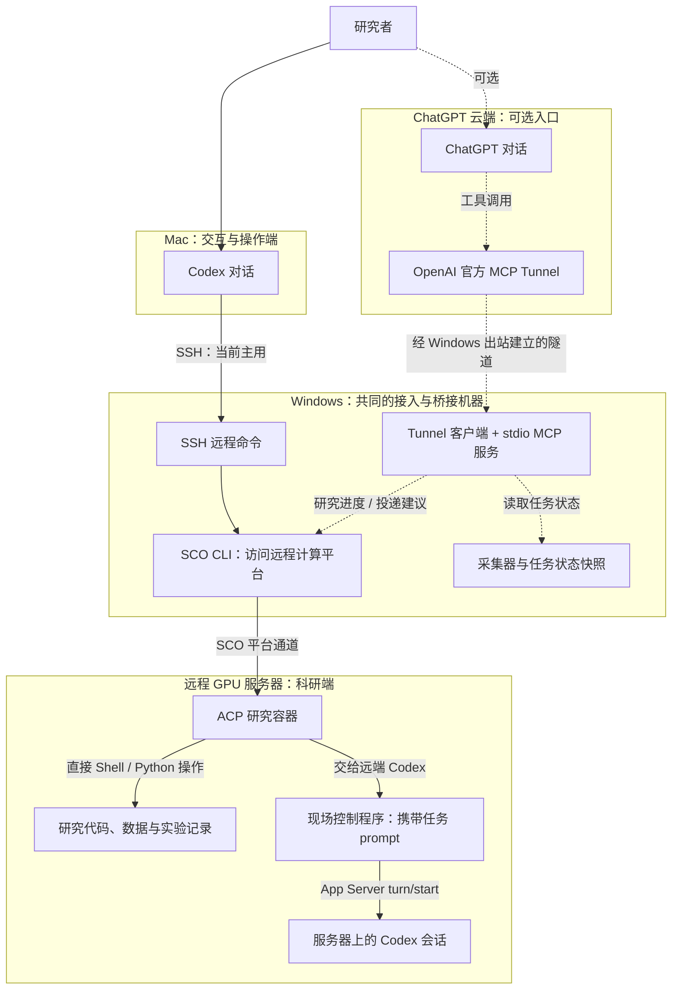

# AutoResearch Lab

[English](README.md) | **简体中文**

面向长时程自主科研 Agent 的持久执行、过程评测与 Agent-native 计算基础设施。

当前现场的主用路径是 **Mac 上的 Codex 经 SSH 到 Windows，再通过 SCO CLI 访问远程 GPU 服务器上的科研环境**。Research Hub 整理了其中的状态采集、平台适配和消息投递组件，并提供 **ChatGPT 经 MCP 接入的可选入口**。

**项目状态：早期研究。** 这里包含从 Research Hub 私有原型整理出的 Python 包、离线测试和研究计划。包内的合成演示与测试用于验证软件行为；真实 GPU Campaign 和科研效果仍需单独验证。

## 支持的平台与可迁移范围

**当前真实平台适配面向 SenseCore ACP，使用 SCO。** SCO 是 SenseCore 专用的命令行工具，不是通用 SSH 客户端，也不是所有 GPU 服务器都会提供的工具。它支持安装在 macOS、Windows 和 Linux 上；我们选择 Windows 作为常在线的接入机器。见 [SCO 官方说明](https://www.sensecore.cn/help/docs/CLI/Introduction)。

当前采集器和 Windows 远程传输依赖 SCO 命令、ACP 任务身份及平台响应格式。公开的真实验收覆盖的是这一环境，不代表已兼容任意 GPU 服务器或其他云平台。

**现已补充标准 OpenSSH 适配器**，可直接连接 POSIX 科研服务器，不依赖 SCO，也不要求 Windows 中转。包含独立 wheel 部署、固定会话建议投递、经审核的进度读取、worker 启动和只读 doctor 检查。见[SSH 部署指南](docs/ssh.md)及[配置示例](examples/ssh-deployment.example.json)。原有 SCO 适配器继续保留。

SSH 模式的任务列表明确返回 `platform_task_listing_not_supported`，不会伪造 ACP 任务状态。新路径已通过真实本机 SSH、安装和 MCP 接口测试，Codex RPC 端使用测试替身；其他云平台、Windows SSH 客户端及真实 GPU／Codex 环境仍需各自验收。见[测试范围](docs/ssh-validation-2026-10-26.md)。Windows 是原现场的选择，不是新增路径的前提。

## 实际使用与功能边界

目前日常主入口是 **Mac Codex → SSH → Windows → SCO → 研究容器**。进入容器后有两类不同的操作：

1. **直接执行 Shell / Python**：安装依赖、修改文件、查询日志、运行测试或实验脚本。这些操作不一定经过服务器上的 Codex，不能全部算作服务器 Agent 自主完成。
2. **启动服务器 Codex 的工作回合**：现场控制程序把任务写成 prompt，通过 Codex App Server 的 `turn/start` 提交，由服务器 Codex 在配置的工具权限与预算内继续工作。这是另一条执行入口，不是 MCP 建议投递 worker 的行为。

Research Hub 的 ChatGPT MCP 入口已经完成查询、建议投递和回执验收，但目前不是日常主入口。它通过 `thread/inject_items` 加入固定会话上下文，不调用 `turn/start`；“已送达”不表示已经执行、完成实验或取得科研结果。

Codex、SSH 和 SCO 是已有工具；我们编写的是围绕具体环境的采集、适配、投递和流程控制代码。测试证明所覆盖的软件行为可用，不证明日常使用占比或科研效率收益；目前没有这两项的量化统计。

## Mac、Windows 和远程服务器如何分工

| 位置 | 当前部署中的职责 |
| --- | --- |
| **Mac：交互与操作端** | 研究者在 Codex 中提出任务，Codex 按需通过已有 SSH 连接在 Windows 上执行命令。研究者也可使用 ChatGPT，经可选的 MCP 入口查询状态或投递建议。 |
| **Windows：远程接入与平台适配端** | 接收 Mac 的 SSH 远程命令，使用已配置的 SCO CLI 访问远程研究容器，并运行本地状态采集与守护。可选的 ChatGPT 入口还使用官方 `tunnel-client` 和 stdio MCP 适配器。 |
| **远程 Linux/GPU 环境：科研端** | 部署 Codex 会话、研究代码与数据，以及私有指导收件箱和 worker；worker 将指导注入固定会话。具备计算环境不代表实验已经启动或完成。 |

实线表示当前主用路径和共用的远程访问通道，虚线表示可选的 ChatGPT MCP 入口。箭头表示请求或操作方向，结果沿原通道返回；图描述部署分工，不表示各段连接或实验已经通过实时验收。



**主用 SSH 路径**依赖现有的 Mac 到 Windows SSH 连接和 Windows 上的 SCO 配置，不需要 ChatGPT MCP Tunnel。仓库中的安装脚本不会自动建立 SSH 接入或登录 SCO。

**可选 MCP 路径**由 ChatGPT 服务端发起调用，经官方 Tunnel 到 Windows。任务状态从 Windows 的采集快照读取；研究记录查询和指导投递再通过 SCO CLI 访问远程研究容器。指导先进入私有收件箱，再由驻留 worker 通过 `thread/inject_items` 注入固定 Codex 会话上下文，不自动启动模型回合或实验。这条 MCP 请求路径不经过 Mac 转发。

原现场另有 **Mac 隐藏输入密钥，经 SSH 交给 Windows 隧道启动器**的辅助脚本，用于启动 Tunnel；它与上图的日常 Codex SSH 操作用途不同。这个密钥输入辅助入口尚未收入本整理版；已收录的启动器支持在 Windows 本机隐藏输入或使用进程环境变量。Windows 到远程研究容器使用 SCO 平台 CLI。部署步骤见[部署说明](docs/deployment.md)。

## 快速开始

需要 Python 3.11+ 和 [uv](https://docs.astral.sh/uv/)。

```bash
uv sync --locked --no-editable
uv run --no-editable research-hub demo
uv run --no-editable pytest -q
```

`demo` 在内存中投影一条合成任务快照，输出中明确标记 `synthetic_demo`。它不读取平台凭证、不连接服务器，也不执行模型或实验。

## 已整理的实现

| 组件 | 用途 | 入口 / 说明 |
| --- | --- | --- |
| `bridge` | 本机只读 ACP 状态采集、数值指标筛选、已批准报告读取 | `research-hub http`；需要部署配置与本地令牌 |
| `mcp_server` | 从已有快照读取状态，通过固定绑定投递建议与查询回执 | `research-hub stdio` |
| `guidance` | 持久化队列、请求去重、官方回执检查、固定会话建议投递 | [指导与进度](docs/components-guidance.md) |
| `progress` | 经过白名单审查的研究记录投影、来源时间和缓存检查 | [指导与进度](docs/components-guidance.md) |
| `executor` | 固定实验请求的策略、状态与 RPC；保留原型的执行门槛 | [执行与验收](docs/components-execution.md) |
| `acceptance` | 固定绑定的观测、预检和事件归属校验 | [执行与验收](docs/components-execution.md) |
| `renewal` | 原实例续起与模板复制两套状态机，显式注入平台 runner | [容器续起](docs/components-renewal.md) |
| `deployment` | 现用部署链路的通用化：采集守护、Windows 计划任务、官方 Tunnel 安装与启动 | [部署说明](docs/deployment.md) |

建议投递的“已收到”表示消息进入指定会话上下文。模型是否运行、实验是否执行，是独立的结果。当前 MCP 不提供实验执行工具；独立 executor 的非文本实验入口仍保留原型的禁用门槛。

## ChatGPT 与服务器 Codex

本版包含 ChatGPT 经 MCP 向服务器上固定 Codex 会话投递指导文本的核心代码，以及状态读取和投递回执查询：

- `submit_research_guidance(request_id, message)`：写入远端私有收件箱，由驻留 worker 通过 `thread/inject_items` 注入绑定会话的上下文。
- `get_research_guidance_status(request_id)`：区分排队、投递不确定、已进入会话上下文。
- `list_research_tasks()` 与 `get_research_progress()`：读取经过筛选的平台状态与研究记录。

这些工具由 `research-hub stdio` 提供。现用的 OpenAI 官方 `tunnel-client` 通过出站连接把 ChatGPT 请求转发到 stdio 适配器，不需要公开本机 HTTP 服务。仓库包含对应的安装、采集守护、计划任务及前台连接脚本，见[部署说明](docs/deployment.md)。`research-hub http` 是另一份只读 Bridge，不包含指导投递工具；远端包、worker 和私有配置仍需要按自己的环境部署。

投递接口不会调用 `turn/start`，回执始终标明 `model_processing_started=false`、`execution_authorized=false`。它包含“把指导送进会话”的实现；“让 Codex 立即开始处理并执行实验”尚未接入这条 MCP 路径。公开包已在独立环境完成真实状态查询、MCP stdio 建议投递与官方回执验收；现有部署的 ChatGPT 云端 Tunnel 已恢复并通过真实查询，但尚未替换为公开包适配器；24 小时持续测试正在运行。配置和边界见[指导与进度](docs/components-guidance.md)。

## 目录

```text
src/research_hub/       可安装的模块，导入不会启动服务
  guidance/            建议队列与传输
  progress/            研究记录投影
  executor/            执行策略与状态
  acceptance/          验收观测
  renewal/             续起 / 复制状态机
  deployment/          采集守护与官方 Tunnel 启动器
scripts/windows/       运行环境、客户端、计划任务及操作员入口
examples/              合成轨迹与配置模板
schemas/               原有研究事件格式草案
tests/                 独立临时目录与假传输上的离线测试
docs/                  研究计划、组件接口和迁移说明
```

## 配置与运行

阿里云新增最小 [ECS 自动启动适配](docs/aliyun-renewal.md)：`research-hub renewal aliyun-ecs init/check/once/watch`，针对固定的已有非抢占式实例。已覆盖离线接口与状态机测试，尚未完成真实阿里云账户验收；不创建／续费实例，也不管理 ECI／ACK 容器。


运行状态与私有配置放在 `RESEARCH_HUB_STATE_DIR`。默认目录为 Linux/macOS 的 `${XDG_STATE_HOME:-~/.local/state}/research-hub`，Windows 的 `%LOCALAPPDATA%/ResearchHub`。安装和导入不会自动创建它。

- 本机 collector 从 `bridge.json` 读取平台及归属配置；模板见 [bridge.example.json](examples/bridge.example.json)，默认关闭平台采集。
- stdio 适配器读取 `collector-state.json`，缺失、过期或来源不明时返回不可用。
- 远端建议和进度读取需要 `remote.json`、`progress.json` 以及远端安装；字段见[组件说明](docs/components-guidance.md)。Windows 传输额外使用 `uv sync --extra windows`。
- executor 和 acceptance 使用独立配置与可信 peer 绑定；原有 SCO 续起仍要求显式 runner／目标。**Linux／Docker 自动续起现已提供 CLI**：`research-hub renewal docker init/check/once/watch`，可在不依赖 SCO 的情况下，按次数预算和持久记录重启固定的已有故障容器。见[Docker 续起部署及边界](docs/docker-renewal.md)；它不负责重新申请云实例或延长 GPU 租约。

迁移现有服务前请阅读[迁移说明](docs/code-organization.md)。本次整理版使用新的包入口和配置位置，原有现场部署仍使用原始文件布局。独立环境的验收结果见[真实链路验收记录](docs/live-validation-2026-10-24.md)。

## 开发检查

```bash
uv run --no-editable ruff check src tests
uv run --no-editable ruff format --check src tests
uv run --no-editable pytest -q
uv build --wheel
```

CI 定义了 Python 3.11 / 3.12 的离线检查，以及独立容器上的真实 Docker 续起测试。跨平台服务部署、真实会话投递、GPU 执行和平台续建需要独立的环境验收。

## 研究问题

我们关心长时程科研 Agent 在真实计算环境中如何持续推进研究，以及怎样评价它：

1. 区分科研假设、Agent 决策、工程代码、外部环境和证据不足导致的失败。
2. 在相同模型、权限、时间与 GPU-hours 下评价可验证科研进展。
3. 检验状态持久化与恢复能力是否带来完成率提升。

参见[研究简介](docs/research-brief.md)、[评测计划](docs/evaluation-plan.md)与[历史系统状态](docs/system-status.md)。这些文档保留了 2026-10-17 的证据范围；2026-10-23 的代码整理不改变其中未完成实验的状态。

## 共享范围

本仓库提供可复用的实现、合成测试与部署说明。部署凭证、现场配置、原始会话、运行快照、checkpoint 及试验数据留在原部署环境。真实科研结果与轨迹需要另行核对和整理；本仓库中的研究计划不代表已完成的 Benchmark 或自主科研成果。

## 许可证

Copyright (c) 2026 Yaoliang Bian.

除另有说明外，本项目采用 **GNU Affero General Public License version 3 only**（SPDX：`AGPL-3.0-only`），完整条款见 [LICENSE](LICENSE)。第三方组件仍遵循各自的许可证。

许可证允许符合条款的商业使用，不要求向作者支付许可费或分成。分发受覆盖的软件、或让用户通过网络与其修改版交互时，需要遵守相应的源码提供义务。不同于本许可证的商业授权须另行书面约定。
